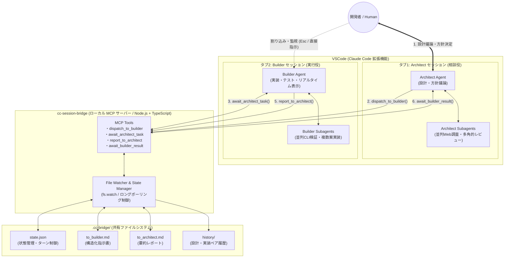
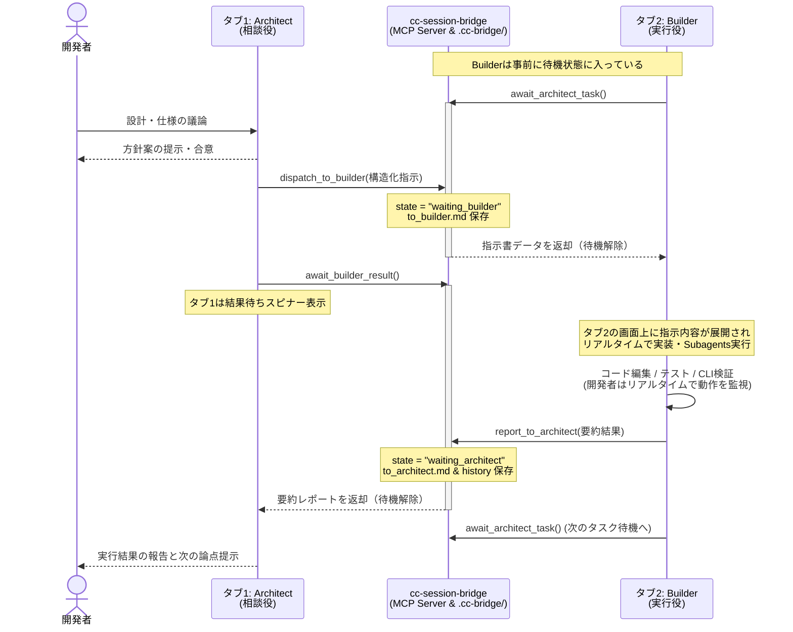

# cc-session-bridge: 設計仕様書（Draft v0.1）

## 1. 開発背景（Background & Problem Statement）

### 1.1 解決したい課題
AIコーディングエージェント（Claude Code など）を用いたソフトウェア開発では、役割に応じてセッションを分離する運用が有効である。

* **相談役（Architect）セッション:** 開発者と上位設計・技術選定・方針決定を議論し、実装用の指示プロンプトを生成する。
* **実行役（Builder）セッション:** 相談役が作成した指示に基づき、実装・テスト・CLI検証などの具体的な作業を遂行する。

しかし、VSCodeのClaude Code拡張機能などで2つの独立したセッションタブを立ち上げて運用する場合、**「相談役が出力した指示プロンプトをコピーして実行役に貼り付け、実行役の結果をコピーして相談役に貼り付ける」という手動の往復作業（コンテキストの橋渡し）**が毎回発生し、開発の思考とテンポを阻害している。

### 1.2 なぜ単一セッション＋Subagentsでは不十分か
単一セッション内でサブエージェント（Subagents）を使うだけでは、以下の要件を満たせない。

1. **コンテキストウィンドウの汚染防止:**
   相談役セッションは抽象度の高い設計議論だけにコンテキストを使いたく、実行役が大量のファイル読み取りや試行錯誤で消費する生ログでコンテキストを占有させたくない。実行役側も同様に、実装に必要な情報だけに集中させたい。
2. **各セッション固有のSubagents活用:**
   * **相談役側:** 大規模なWeb調査や、異なる視点からの設計レビューを並列実行するために独自のSubagentsを起動したい。
   * **実行役側:** 異なるパラメータでのCLIスクリプト検証や、複数アーキテクチャパターンの比較実装を並列実行するために独自のSubagentsを起動したい。
3. **リアルタイムな可視性と介入可能性（Human-in-the-Loop）:**
   バックグラウンドのヘッドレス実行（`claude -p` 等）ではなく、VSCodeのタブ画面上で「どのような指示が実行されているか」「どのツールやSubagentsがリアルタイムで動いているか」「最終的にどのような結果が返るか」を人間が目で見て確認し、必要に応じていつでも停止・修正指示を出せる状態を維持したい。

### 1.3 プロダクトビジョン
ローカルのMCP（Model Context Protocol）サーバーと共有ステートファイルを介して2つの独立したセッションを非同期かつリアルタイムに接続し、人間によるコピペ作業をゼロにする。また、セッション間を行き来した「設計意図（Why）」と「実装結果（What）」のペアを構造化ログ（ADR）として自動蓄積し、世界中のClaude Code / AIエージェントユーザーが使えるOSSツール（`cc-session-bridge`）として育てる。

---

## 2. 想定仕様（Specifications）

### 2.1 コアコンセプト
* **ロールベース分離:** `Architect（相談役）` と `Builder（実行役）` の2つの独立セッションを橋渡しする。
* **リアルタイム可視化（VSCode 2タブ運用）:** 既存のVSCode拡張機能の2つのタブをそのまま活かし、各タブのチャットUI上でツール実行と出力をリアルタイムに表示する。
* **コンテキスト蒸留（Context Distillation）:** 生ログをそのまま横流しせず、構造化された指示書（Plan）と要約報告書（Report）のみをハンドオフすることで双方のコンテキストをクリーンに保つ。
* **人間による割り込みの許容:** 実行中のタブを人間がいつでも停止（Esc等）し、直接修正指示を出した上でハンドオフを再開できる。

### 2.2 機能要件

#### A. MCPツールインターフェース（4つの基本ツール）
ローカルMCPサーバーとして動作し、各セッションに以下のツールを提供する。

| ツール名 | 呼び出し主体 | 役割・動作仕様 |
| :--- | :--- | :--- |
| `dispatch_to_builder` | Architect | 構造化された指示書（目的・背景・対象・制約・完了条件）を `.cc-bridge/to_builder.md` と履歴に保存し、状態を `waiting_builder` に遷移させる。 |
| `await_architect_task` | Builder | 状態が `waiting_builder` になるまで待機（ロングポーリング）し、指示が届いたらその内容を戻り値としてBuilderセッションに展開する。 |
| `report_to_architect` | Builder | 実行結果の要約（ステータス・変更ファイル・検証ログ・未解決の論点）を `.cc-bridge/to_architect.md` と履歴に保存し、状態を `waiting_architect` に遷移させる。 |
| `await_builder_result` | Architect | 状態が `waiting_architect` になるまで待機し、Builderからの報告が届いたらその内容を戻り値としてArchitectセッションに返す。 |

#### B. タイムアウト・再待機制御（ポーリング耐性）
* MCPクライアント側のツール実行タイムアウトを防ぐため、1回の `await_*` 呼び出しは一定時間（例: 30〜60秒）で `status: "pending"` を返し、ロールプロンプトの指示に従ってエージェントが自然に再待機ループを回せる設計にする。

#### C. ワークスペース共有ディレクトリ構造（`.cc-bridge/`）
Git管理外（`.gitignore` 対象）としてプロジェクトルートに配置する。

```text
.cc-bridge/
├── state.json          # 現在の状態 (idle / waiting_builder / waiting_architect / turn_count)
├── to_builder.md       # Architect → Builder への最新の構造化指示書
├── to_architect.md     # Builder → Architect への最新の結果サマリー
└── history/            # 往復ごとのペアログ (001_plan.md, 001_report.md, ...)

```

#### D. カスタムスラッシュコマンドによるロール初期化

プロジェクト内の `.claude/commands/` に2つのコマンドを同梱する。

* `/architect`: タブ1を相談役モードとして初期化（設計議論 → `dispatch_to_builder` → `await_builder_result` のループ定義）。
* `/builder`: タブ2を実行役モードとして初期化（`await_architect_task` → 実装・Subagents検証 → `report_to_architect` → 再待機のループ定義）。

#### E. 安全装置（ガードレール）

* **ターン上限・ループ防止:** `state.json` で連続自動往復回数（`turn_count`）を管理し、上限に達した場合は自動的に人間への確認（Human Approval）を要求する。
* **セッション・チャネル分離:** 複数のVSCodeウィンドウや複数ペアを同時に立ち上げても混線しないよう、`channel_id`（デフォルト: `default`）による名前空間分離をサポートする。

---

## 3. 想定アーキテクチャ図（Architecture）

### 3.1 システム全体構成図



### 3.2 ハンドオフ・シーケンス図（1往復のライフサイクル）



---

## 4. 今後の実装ステップ（Roadmap）

1. **Phase 1: MVP（ローカル動作検証）**
* TypeScript + `@modelcontextprotocol/sdk` で最小のMCPサーバーを実装。
* `.mcp.json` と `.claude/commands/{architect,builder}.md` を作成し、VSCode 2タブ間での往復動作とタイムアウト再待機を検証。


2. **Phase 2: プロトコル洗練と安全装置**
* `to_builder.md` / `to_architect.md` の構造化スキーマ最適化（コンテキスト圧縮率の向上）。
* 無限ループ防止の `max_turns` 制御と、エラー発生時のリトライ・人間エスカレーション処理の実装。


3. **Phase 3: OSS公開・コミュニティ化**
* `npx cc-session-bridge init` で任意のリポジトリに `.mcp.json` とコマンドテンプレートを自動セットアップするCLI化。
* 英語README、デモGIF（VSCode 2タブが自動で連携する様子）、Contributingガイドを整備してGitHubに公開。
